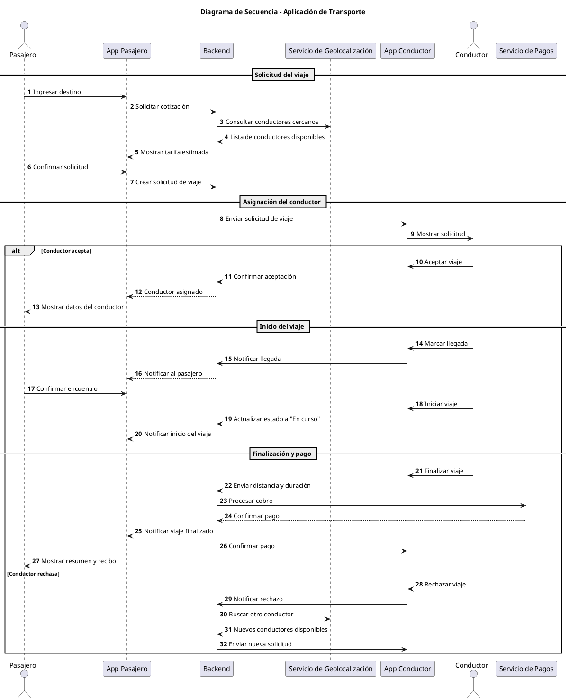
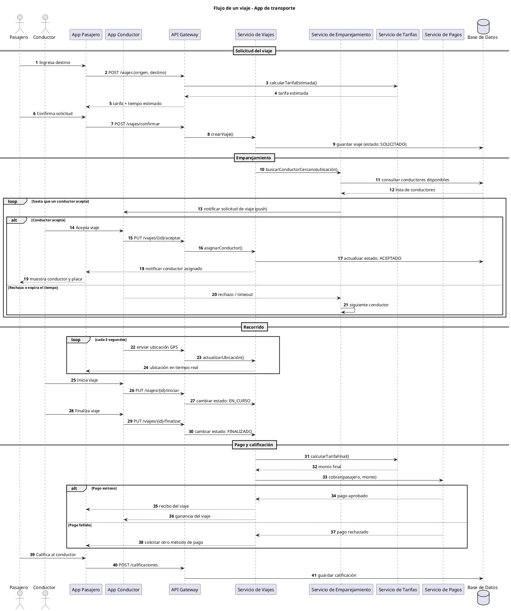

# Hito 1 – Parte II, Actividad 1: Construyendo diagramas con GenAI
Grupo 11 – Caso OrigenTours

## Prompt 1: Diagrama de secuencia en PlantUML (app de transporte similar a Uber)
Prompt usado en ChatGPT y en Claude: "Dame un ejemplo de un diagrama de secuencia en PlantUML de una app de transporte similar a Uber"

### Respuesta de ChatGPT

Actores y componentes: Pasajero, App del pasajero, Backend, Servicio de geolocalización, Conductor, Servicio de pagos.

ChatGPT acompañó el código con un resumen conceptual del flujo en 5 pasos (solicitud, asignación, aceptación, ejecución, pago) y una tabla explicando los elementos UML usados (actor, participant, ->, -->, alt/else, ==, autonumber).

### Respuesta de Claude

Flujo completo de un viaje: solicitud, asignación de conductor, recorrido y pago.

Claude explicó los elementos usados: autonumber, secciones == ==, loop para el reintento de emparejamiento y el GPS, alt/else para los caminos alternos y --> para las respuestas.

### Análisis comparativo del grupo
- Claude propuso una arquitectura más rica: API Gateway, microservicios (Viajes, Emparejamiento, Tarifas, Pagos), base de datos, endpoints REST explícitos, estados del viaje (SOLICITADO, ACEPTADO, EN_CURSO, FINALIZADO), un loop de reintento con timeout, seguimiento GPS en tiempo real, pago fallido y calificación.
- ChatGPT fue más didáctico (resumen conceptual y tabla de elementos UML) e incluyó detalles de experiencia de usuario (marcar llegada, confirmar encuentro), pero con un backend monolítico, sin base de datos y modelando el reintento con alt en lugar de loop.
- El mismo prompt produjo enfoques distintos: comparar modelos agrega valor antes de elegir uno.

## Prompt 2: Renderizado del diagrama
Prompt usado en ambos: "Me puedes mostrar la gráfica de ese lenguaje?"

### ChatGPT
No renderizó el diagrama. Entregó el enlace a PlantUML Online para generarlo desde el código, una imagen de referencia ilustrativa tomada de un sitio de diseño de sistemas (aclarando que no corresponde al código) y una guía de lectura del diagrama (líneas de vida, mensajes, bloques alt/else, tiempo descendente).

### Claude
Renderizó una gráfica del diagrama directamente en la conversación, en versión simplificada: agrupó participantes (API, tarifas y notificaciones dentro de "App móvil" y "Viajes") y omitió los bloques alt y el loop de GPS para que se leyera bien, explicando esas decisiones. Remitió a PlantUML Online para la imagen exacta del código.

### Análisis comparativo del grupo
Ninguno de los dos ejecuta PlantUML realmente. Claude se acercó más al objetivo generando una visualización propia y explicando sus simplificaciones; ChatGPT fue más transparente al delegar el renderizado en la herramienta adecuada. Para resultados exactos, el código debe pegarse en plantuml.com o renderizarse con una extensión del IDE.

## Prompt 3: Arquitectura AWS con la librería Diagrams (Python)
Prompt usado en ambos: "Ahora ayúdame a crear el diagrama de arquitectura utilizando la librería Diagrams y Python para pintarla suponiendo que uso AWS"

### ChatGPT
Entregó un script Python con la librería Diagrams basado en ECS Fargate, RDS PostgreSQL, Lambda, API Gateway, Cognito, DynamoDB, ElastiCache, SQS/SNS, S3 y CloudWatch. Acompañó el código con una tabla de componentes y responsabilidades, el flujo explicado en 6 pasos, instrucciones de instalación (pip install diagrams + Graphviz) y mejoras sugeridas: WebSocket para tiempo real, pasarela de pagos tipo Stripe y Auto Scaling. Incluyó imágenes de referencia tomadas de la web y recomendó diferenciar el diagrama de secuencia (comportamiento dinámico) del de arquitectura (infraestructura).

### Claude
Entregó el script arquitectura_aws.py con una arquitectura orientada a eventos: borde con Route 53, CloudFront y WAF; Cognito; API Gateway REST y WebSocket; seis microservicios en EKS (Viajes, Matching, Tarifas, Ubicación, Pagos, Notificaciones); Kinesis para el GPS en vivo; EventBridge, SQS y SNS; datos en Aurora, DynamoDB, ElastiCache Redis (geo-índice) y S3; CloudWatch y Stripe. Aclaró que no podía ejecutar el script en su entorno y dio las instrucciones para correrlo localmente.

### Análisis comparativo del grupo
Ambos coinciden en el núcleo (API Gateway, Cognito, DynamoDB, SQS/SNS, S3, CloudWatch) y ninguno renderiza la imagen desde el chat: el script debe ejecutarse localmente con la librería Diagrams y Graphviz. ChatGPT fue más didáctico (tabla, flujo, consideraciones); Claude más profundo en arquitectura de eventos y tiempo real (Kinesis, EventBridge, WebSocket, geo-índice). Para la PoC tomaremos el núcleo común y lo simplificaremos: una PoC no necesita microservicios ni streaming.
