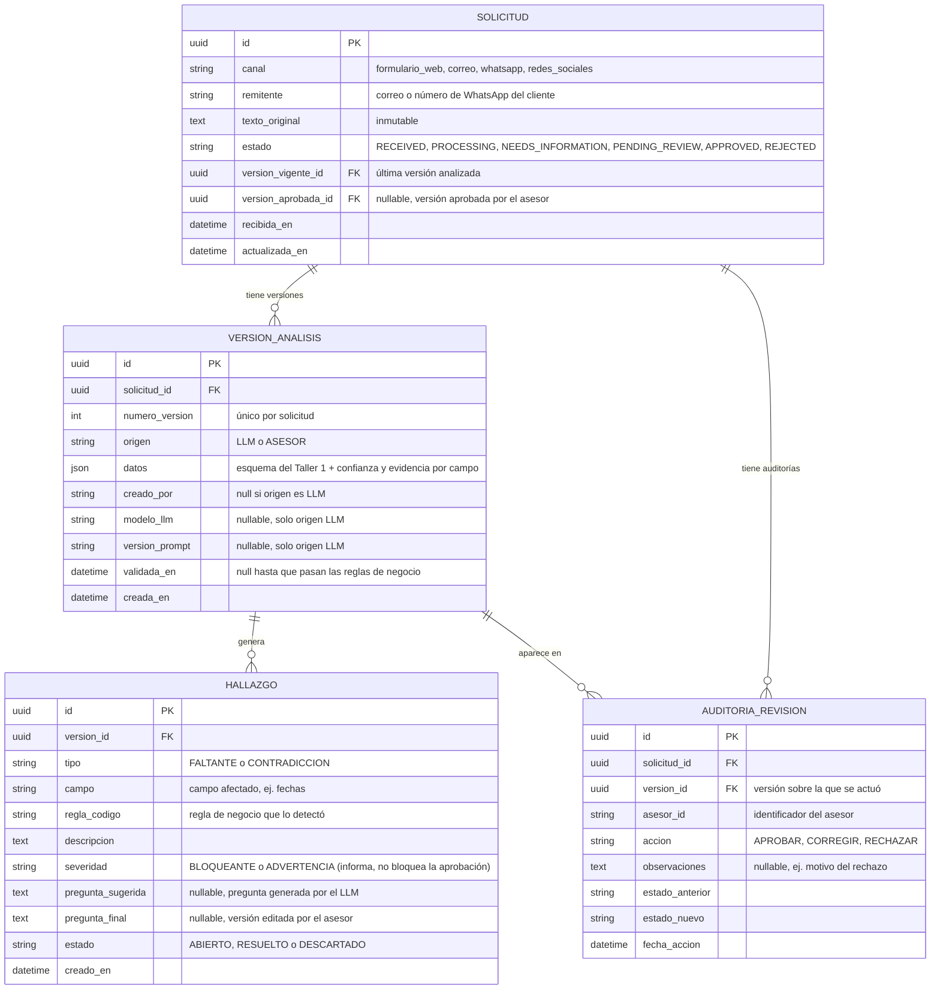
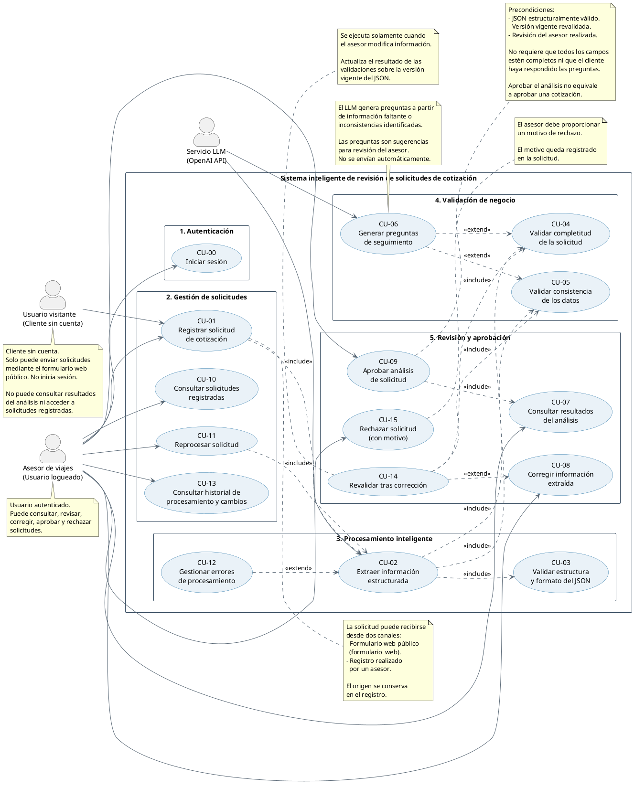
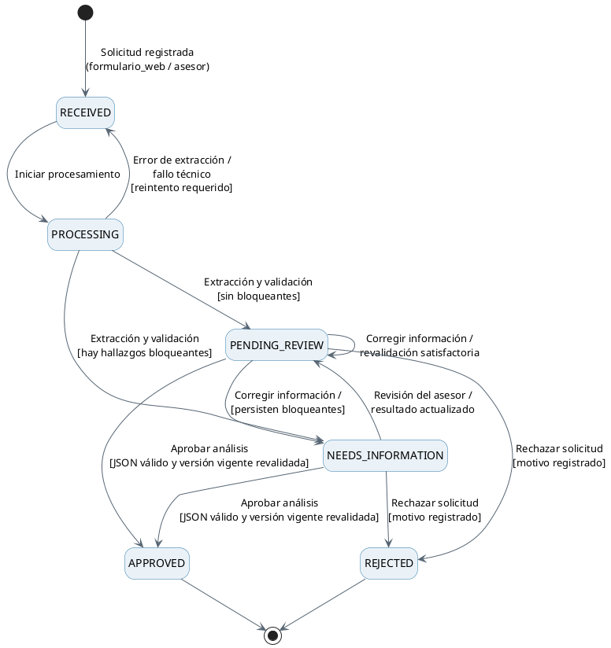

# Documento de especificación de requerimientos
## PoC «Revisor inteligente de solicitudes de cotización» – OrigenTours
Grupo 11 · MAIT4202 Inteligencia Artificial para negocios digitales · Universidad de los Andes · Noviembre 2026

## 1. Contexto y objetivo
OrigenTours es una agencia de viajes que diseña experiencias turísticas personalizadas. Los clientes piden cotizaciones en texto libre por correo, WhatsApp o formulario web. Hoy un asesor revisa cada solicitud a mano (actividad 3 «Revisar la solicitud» del proceso de cotización), lo que genera varias rondas de preguntas al cliente y variabilidad entre asesores.

Objetivo de la PoC: demostrar con datos sintéticos que un LLM puede extraer los datos de la solicitud a un JSON estructurado, que reglas deterministas detectan lo faltante y lo contradictorio, y que se generan preguntas de seguimiento útiles, con un asesor que revisa, corrige y aprueba (human-in-the-loop).

## 2. Alcance
- Dentro: registro de la solicitud (asesor o formulario web público), extracción con LLM, validación de esquema, completitud y consistencia, generación de preguntas, revisión/corrección/aprobación/rechazo por el asesor, historial y auditoría.
- Fuera: conexión automática a correo o WhatsApp, envío de mensajes al cliente, elaboración de la cotización, proveedores y pagos.
- Stack: frontend React; backend Node.js con Express; PostgreSQL con JSONB; LLM por API de OpenAI. Despliegue tentativo en AWS de bajo costo (CloudFront + S3 para el frontend, una EC2 para Express, RDS PostgreSQL en subred privada, clave del LLM en SSM Parameter Store).

## 3. Actores
- Visitante (cliente sin cuenta): solo envía una solicitud desde el formulario web público; no inicia sesión ni ve el análisis.
- Asesor (usuario logueado): registra, consulta, corrige, aprueba y rechaza solicitudes.
- Servicio LLM (OpenAI API): extrae los datos (CU-02) y genera las preguntas (CU-06).

## 4. Esquema JSON de extracción (heredado del Taller 1)
```json
{
  "canal_origen": "correo | redes_sociales | formulario_web | whatsapp",
  "idioma": "es",
  "datos_extraidos": {
    "tipo_cliente": "individual | grupo | grupo_academico | organizacion",
    "tipo_experiencia": "texto",
    "destino": "texto o null",
    "intereses": ["texto"],
    "fechas": {"inicio": "AAAA-MM-DD o null", "fin": "AAAA-MM-DD o null", "flexibilidad": "texto o null"},
    "numero_viajeros": {"adultos": 0, "menores": 0, "edades_menores": []},
    "restricciones": {"alimentarias": [], "movilidad": [], "logisticas": []},
    "presupuesto_referencia": null,
    "ciudad_origen": null
  },
  "confianza_por_campo": {"campo": 0.0},
  "evidencia_por_campo": {"campo": "fragmento del texto original"}
}
```
Lo que el cliente no menciona queda en null; el modelo nunca inventa datos.

## 5. Casos de uso
| ID | Caso de uso | Actor | Prioridad |
|---|---|---|---|
| CU-00 | Iniciar sesión | Asesor | P0 |
| CU-01 | Registrar solicitud de cotización (asesor o formulario web) | Visitante, asesor | P0 |
| CU-02 | Extraer información estructurada | Sistema + LLM | P0 |
| CU-03 | Validar estructura y formato del JSON | Sistema | P0 |
| CU-04 | Validar completitud de la solicitud | Sistema | P0 |
| CU-05 | Validar consistencia de los datos | Sistema | P0 |
| CU-06 | Generar preguntas de seguimiento | Sistema + LLM | P0 |
| CU-07 | Consultar resultados del análisis | Asesor | P0 |
| CU-08 | Corregir información extraída | Asesor | P0 |
| CU-14 | Revalidar tras corrección | Sistema | P0 |
| CU-09 | Aprobar análisis de la solicitud | Asesor | P0 |
| CU-15 | Rechazar solicitud (con motivo) | Asesor | P0 |
| CU-10 | Consultar solicitudes registradas | Asesor | P1 |
| CU-11 | Reprocesar solicitud | Asesor | P1 |
| CU-12 | Gestionar errores de procesamiento | Sistema | P1 |
| CU-13 | Consultar historial de procesamiento y cambios | Asesor | P1 |

## 6. Requerimientos funcionales
- RF-01 Registrar una solicitud en texto libre (asesor o formulario web público) con texto original, canal y remitente. (CU-01)
- RF-02 Extraer con el LLM los datos al esquema JSON de la sección 4, con confianza y evidencia por campo y null en lo no mencionado. (CU-02)
- RF-03 Validar que la respuesta cumpla el esquema; reintentar hasta 2 veces y, si falla, devolver la solicitud a RECEIVED. (CU-03, CU-12)
- RF-04 Validar completitud y consistencia con reglas deterministas y registrar cada hallazgo con tipo, campo, regla y severidad. (CU-04, CU-05)
- RF-05 Generar con el LLM una pregunta de seguimiento por hallazgo. (CU-06)
- RF-06 Mostrar al asesor el texto original, los datos extraídos, los hallazgos y las preguntas. (CU-07)
- RF-07 Permitir corregir campos y editar preguntas; cada corrección crea una versión nueva y se revalida. (CU-08, CU-14)
- RF-08 Aprobar el análisis de la versión vigente validada o rechazar con motivo. (CU-09, CU-15)
- RF-09 Listar solicitudes con su estado y consultar historial de versiones y auditoría. (CU-10, CU-13)
- RF-10 Autenticar al asesor; el visitante solo envía solicitudes por el formulario público, sin sesión. (CU-00)

## 7. Reglas de negocio
- RN-01 Obligatorios para cotizar: tipo de cliente, destino o tipo de experiencia, fecha de inicio y de fin, número de viajeros (adultos y menores) y ciudad de origen. Presupuesto y restricciones son recomendados.
- RN-02 La fecha de fin es posterior a la de inicio y ninguna está en el pasado.
- RN-03 Si hay menores, se deben conocer sus edades.
- RN-04 Toda extracción cumple el esquema; lo no mencionado es null y nunca se inventa.
- RN-05 Cada pregunta de seguimiento corresponde a un hallazgo.
- RN-06 El texto original es inmutable y las versiones no se sobrescriben.
- RN-07 Solo se aprueba la versión vigente validada; se permite aprobar con hallazgos abiertos (aprobar el análisis no es aprobar la cotización).
- RN-08 Todo rechazo exige motivo y toda acción del asesor queda en auditoría.
- RN-09 Severidad: faltan obligatorios (RN-01), fechas inconsistentes (RN-02) o menores sin edades (RN-03) son BLOQUEANTES; falta de presupuesto o restricciones es ADVERTENCIA.
- RN-10 Catálogo único de canal: formulario_web, correo, whatsapp, redes_sociales. formulario_web solo lo asigna el sistema.

## 8. Requerimientos no funcionales
- RNF-01 Seguridad: clave del LLM fuera del código (.env excluido del repositorio en desarrollo, Parameter Store en AWS) y HTTPS.
- RNF-02 Privacidad: en la PoC se usan datos sintéticos; para el piloto el texto se anonimiza antes del LLM con el Privacy Vault del Taller 2.
- RNF-03 Trazabilidad: se guardan modelo y versión del prompt de cada extracción.
- RNF-04 Costo: infraestructura mínima; una llamada al LLM para extraer y otra para generar preguntas.
- RNF-05 Rendimiento: respuesta síncrona en pocos segundos (meta menor a 30 s).
- RNF-06 Calidad: pruebas automáticas sin red (LLM y base de datos simulados).

## 9. Estados de la solicitud
RECEIVED → PROCESSING → NEEDS_INFORMATION (hay al menos un hallazgo BLOQUEANTE) o PENDING_REVIEW (sin hallazgos o solo ADVERTENCIAS). Si la extracción falla tras 2 reintentos, vuelve a RECEIVED. Desde NEEDS_INFORMATION y PENDING_REVIEW el asesor puede corregir (revalida), aprobar (APPROVED) o rechazar con motivo (REJECTED).

## 10. Diagramas
### 10.1 Diagrama de secuencia (PlantUML)

```plantuml
@startuml
title PoC - Revisor inteligente de solicitudes (OrigenTours)
autonumber

actor "Asesor" as Asesor
participant "Frontend web" as FE
participant "Backend" as BE
participant "Servicio LLM" as LLM
database "Base de datos" as DB

== 1. Recepción de la solicitud ==
Asesor -> FE: Pega o carga el texto de la solicitud\n(correo / WhatsApp)
FE -> BE: POST /solicitudes {texto, canal}
activate BE
BE -> DB: Guardar solicitud (estado = RECEIVED)
DB --> BE: solicitudId
BE -> DB: Actualizar estado = PROCESSING
note right of FE: El Frontend queda esperando la respuesta\n(procesamiento síncrono)

== 2. Extracción de datos con LLM ==
BE -> LLM: Prompt + texto libre + esquema JSON esperado
activate LLM
LLM --> BE: JSON estructurado\n(tipo_cliente, destino, fechas, n_personas,\npresupuesto, restricciones)
deactivate LLM

opt El JSON es inválido
    loop máx. 2 reintentos
        BE -> LLM: Reintentar con instrucción de corrección
        LLM --> BE: JSON estructurado
    end
end

alt Extracción válida
    BE -> DB: Guardar extracción (versión 1)

    == 3. Validación con reglas de negocio ==
    BE -> BE: Validar completitud\n(campos obligatorios presentes)
    BE -> BE: Validar consistencia\n(fechas y edades de menores)
    BE -> BE: Construir lista de hallazgos\n(campos faltantes y contradictorios)

    == 4. Preguntas de seguimiento y estado ==
    alt Hay hallazgos BLOQUEANTES
        BE -> LLM: Generar preguntas (JSON extraído + hallazgos)
        activate LLM
        LLM --> BE: Preguntas de seguimiento para el cliente
        deactivate LLM
        BE -> DB: Guardar hallazgos y preguntas\n(estado = NEEDS_INFORMATION)
    else Sin hallazgos o solo advertencias
        BE -> DB: Guardar resultado\n(estado = PENDING_REVIEW)
    end

    BE --> FE: 201 Created {resultado completo, estado}
    deactivate BE
    FE -> Asesor: Muestra datos extraídos, alertas\ny preguntas sugeridas
else Extracción fallida tras reintentos
    BE -> DB: Restaurar estado = RECEIVED (reintentable)
    BE --> FE: 422 Error de extracción
    deactivate BE
    FE -> Asesor: Muestra error y opción de reintentar
end

note over Asesor, DB
  Las secciones siguientes aplican cuando hay un resultado
  en estado PENDING_REVIEW o NEEDS_INFORMATION.
  Ambos estados son revisables por el asesor.
end note

== 5. Revisión humana (human-in-the-loop) ==
Asesor -> Asesor: Revisa el resultado

alt Rechaza
    Asesor -> FE: Rechazar (con motivo)
    FE -> BE: POST /solicitudes/{id}/rechazo {motivo}
    activate BE
    BE -> DB: Estado = REJECTED + motivo + auditoría
    BE --> FE: 200 OK {estado = REJECTED}
    deactivate BE
    FE -> Asesor: Confirma el rechazo
else Aprueba el análisis (con o sin edición previa)
    opt El asesor edita campos
        loop Por cada edición
            Asesor -> FE: Corrige campos extraídos
            FE -> BE: PUT /solicitudes/{id}/resultado {cambios}
            activate BE
            BE -> DB: Guardar versión editada + registro de cambios
            BE -> BE: Re-ejecutar validaciones de negocio\nsobre la versión editada
            alt Persisten hallazgos
                BE -> DB: Actualizar hallazgos\n(estado = NEEDS_INFORMATION)
            else Sin hallazgos
                BE -> DB: Actualizar hallazgos\n(estado = PENDING_REVIEW)
            end
            BE --> FE: 200 OK {versión validada, hallazgos, estado}
            deactivate BE
            FE -> Asesor: Muestra resultado revalidado
        end
    end

    Asesor -> FE: Aprobar análisis
    FE -> BE: POST /solicitudes/{id}/aprobacion {versión}
    activate BE
    BE -> DB: Consultar versión vigente y su validación
    DB --> BE: Versión + resultado de validación

    alt La versión fue validada
        note right of BE
          Aprobar el análisis no es aprobar la cotización:
          se permite aprobar en NEEDS_INFORMATION y los
          hallazgos pendientes quedan registrados.
        end note
        BE -> DB: Estado = APPROVED + auditoría\n(asesor, fecha y hora, versión)
        BE --> FE: 200 OK {estado = APPROVED}
        FE -> Asesor: Confirma y deja listo el análisis\npara responder al cliente
    else La versión editada no fue validada
        BE --> FE: 409 Conflict (validación pendiente)
        FE -> Asesor: Solicita revalidar antes de aprobar
    end
    deactivate BE
end
@enduml
```

### 10.2 Modelo de datos (Mermaid)

### 10.3 Casos de uso (PlantUML)

### 10.4 Estados (PlantUML)

## 11. Endpoints previstos (backend)
- POST /solicitudes {texto, canal, remitente} → 201 con el resultado completo (análisis síncrono)
- GET /solicitudes y GET /solicitudes/{id}
- PUT /solicitudes/{id}/resultado {cambios} → nueva versión revalidada
- POST /solicitudes/{id}/aprobacion {version} → 200 o 409 si la versión no fue validada
- POST /solicitudes/{id}/rechazo {motivo}
